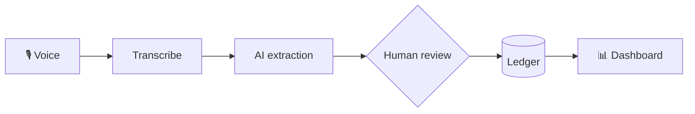

---

## 🧭 What I do

| | |
|---|---|
| 🗄️ **Data engineering** | Warehousing and analytics on SQL Server, with SSAS cubes on top |
| 🤖 **Applied AI** | Turning speech and free text into clean, reviewable structured records |
| ☁️ **Cloud & DevOps** | Terraform, ECS Fargate, and CI/CD with security gates built in |

## 🚀 Featured projects

### 🛡️ [SentinelCI](https://github.com/tarunkay7/sentinel-ci)
A CI/CD pipeline on AWS where every push is **secret-scanned → built → vulnerability-scanned → SBOM'd → signed → deployed**.
`GitHub Actions` · `Gitleaks` · `Trivy` · `Cosign` · `Terraform` · `ECS Fargate`

### 🎙️ Ledgr — voice-driven expense tracking
Say what you spent; AI extracts the transactions, you review them, and only then do they hit your ledger. Web dashboard + native Android client, per-user data isolation, OTP sign-up.
`JavaScript` · `Flutter/Dart` · `Speech → structured data` · *(code available on request)*

## 📬 Let's talk

